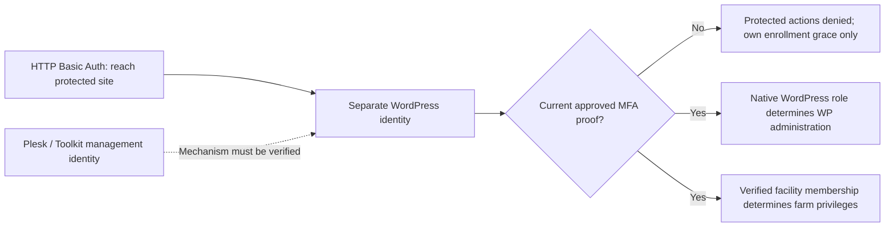

# 01 — Platform Architecture

## Accounts & Access — corrected identity model, November 2, 2026

**Design only; no dashboard or account change is implemented by this correction.** The owner
clarification in [Issue11 comment](https://github.com/kks787-ship-it/KksSandbox/issues/11#issuecomment-6584204812)
supersedes the recent proposal to identify Kris with the existing technical WordPress admin
and reuse that identity for Farm Master. The reported Plesk screenshot establishes a configured
WordPress administrator login; its human controller/numeric ID and MFA remain privately unverified.
The screenshot/private account fields are not reproduced here. A protected-site login is a
different authentication layer and is never joined to a WordPress user by matching names.

### Canonical identity inventory

| Context / account | Identity source and authority | Current planning state |
| --- | --- | --- |
| Plesk control panel / WordPress Toolkit | Hosting-management identity outside WordPress; may manage or initiate a WordPress login through its own integration | Preserve existing management access. Exact mechanism, human controller and recovery mapping require private verification |
| Plesk-created WordPress technical Administrator | Existing native WordPress account created at installation; WordPress maintenance capabilities | Preserve account/native role. Do not infer its controller, UID, farm membership or MFA from Plesk access or an HTTP protection login |
| Sandbox HTTP Basic Auth gate | Web-server directory/site protection, not a WordPress account | Allows reaching the protected site only. No WordPress UID, farm role or second-factor proof is created |
| Kris's Farm Owner / Master | **Proposed separate, individually controlled WordPress Subscriber identity** plus protected Digital Ranch ownership after approved bootstrap | Owner-review recommendation, not account creation or permission authorization. Actual login/email/UID remain private and undecided |
| Beth / other employees | Individually verified WordPress accounts with proposed Subscriber baseline plus reviewed farm group/overrides | No native administrator promotion or automatic farm membership. Beth's Head Trainer/resource/availability choices remain separate decisions |

WordPress Administrator does not grant a Plesk control-panel account; Plesk access does not prove
that a WordPress session completed MFA. A future Farm Master controls only implemented farm
privileges, not WordPress/server administration, emergency, payments or contract authority.
The same person may control multiple separately approved accounts, but distinct accounts are
**not proof of distinct people** or an independent human approval. Never claim two-person control
solely because two numeric IDs or browser sessions differ.

The diagram shows proposed **protected actions after approved MFA enforcement**, not a claim
about the current deployment or a new restriction on legitimate public read views.



### Bootstrap decision and source review

**Recommend retaining the pinned two-identity design**, using the privately verified existing
technical WordPress Administrator as operator and a separately approved Kris business account
as proposed owner. The business account is intentional separation of duties, not a duplicate
created by assuming a Basic Auth name is a WordPress identity. No new administrator, Beth
promotion, throwaway operator or same-ID exception is needed for this model.

Source remains **`2fd02a2a1d3518289f7c4aa19bc9ddfb1dec91b1`**, Scheduling0.4.0/adapter0.2.0,
schema3/15 tables and the same45-file candidate. Source review confirms:

- `CSF_Scheduling_Identity::invitation()` rejects equal operator/owner WordPress IDs and binds
  site/environment/facility/source/schema/policy/registry/revision/action/expiry/exact UUIDs.
- `authorize()` requires the actual approving account's own browser proof, mandatory-admin
  policy enabled and challenge age<=300seconds; CLI and Basic Auth cannot satisfy it.
- Operator request/consumption requires the exact native administrator with `manage_options`;
  proposed owner approval requires the exact other identity. Transfer also needs outgoing-master
  consent. No checkbox, Plesk screenshot, role or matching login string substitutes for these.
- Prior approvals are signed, revalidated for revocation/credentials/expiry under the transaction
  lock, and consumed atomically with registry, mirrors, sessions, revision, history and audit.
  Uncertain responses resolve by the original command UUID, preserving idempotency/last-master rules.

Private verification must establish who independently controls the operator and owner channels.
If owner policy requires a second human, name/verify that authorized operator privately before
bootstrap; code cannot establish human independence. A single human with separate maintenance
and business accounts provides role/session separation, not an independent second-person check.
Trusted technical WordPress administrators and hosting/root operators remain privileged trust
boundaries. Account separation reduces routine exposure; it does not make the hosting owner or
an administrator able to install executable extensions an untrusted party the plugin can defeat.

**Alternative, not recommended for this pilot:** reusing one WordPress UID for operator and
owner requires a newly reviewed sole-owner protocol with an independently controlled approval
authority, explicit recovery/expiry/replay/audit model and new source pin plus full security tests.
A checkbox, second tab, copied factor proof, CLI bypass or deletion of the unequal-ID check is
not such a protocol. Do not change current code merely to fit an unverified account mapping.

### Proposed owner-facing Accounts & Access dashboard

Extend the existing Digital Ranch navigation with **Accounts & Access** in a later explicitly
authorized UI build. Reuse Team & Permissions as the only farm-privilege editor and the existing
MFA provider/adapter; do not build a second grant or authentication engine. This design adds no
current route, schema, role, option, identity directory or server-side discovery job.

| Proposed view | What the owner sees | Boundary / allowed next action |
| --- | --- | --- |
| Account inventory | Approved person label, account type/purpose, reported vs privately verified identity source, native WP role and separate farm role | HTTP gate and Plesk are separate context cards, never selectable employee WordPress accounts |
| Farm access | Group, explicit grants/denials, effective privileges and provenance; protected Master identity shown separately | Existing Team & Permissions preview/confirm/audit; no create_users/promote_users/manage_options implied |
| Authentication | Provider availability, enrollment status, **your own** current-session proof/expiry; other employees' current session labeled unknown | Enrollment is not verified login. No borrowing/probing an employee's session or declaring them authenticated from their enabled factor |
| Recovery readiness | Reviewed/needs review, review date and private custody-record reference | No seed, QR image, password, recovery code, browser token, raw proof or private evidence contents |
| Integrations & admin access | Plesk/Toolkit path: unverified/tested/incompatible; HTTP gate distinct; application-password/XML-RPC impact | Review-only technical change request; no silent provider/config/SSO action or disabling MFA to pass a test |
| History | Authorized farm permission audit and reviewed change/recovery references | No raw infrastructure credentials, login logs or unscoped user directory |

Suggested small-screen layout:

```text
Digital Ranch > Accounts & Access                     [Design only]
Farm access | Authentication & recovery | Technical access

Kris — proposed business account
WordPress: Subscriber (proposed)     Farm: Master (not provisioned)
Identity: needs private verification MFA enrolled: not verified
Your current session: unavailable    Recovery custody: needs review
[Review farm permissions] [Review account/MFA setup requirements]

Beth — proposed staff account
WordPress: Subscriber (proposed)     Farm: Head Trainer (not provisioned)
[Group defaults / individual choices / effective-access preview]

Technical WordPress administrator — existing, controller unverified
WordPress: Administrator             Farm: no automatic membership
[Private technical review required]

Protected-site HTTP gate / Plesk management: separate contexts
These do not identify an employee or satisfy WordPress MFA.
```

Technical identity/recovery detail is owner/master-only by design; existing ordinary
`team_view` delegates keep their currently authorized employee projection. New sensitive
inventory privileges require a later reviewed capability change, not inferred access. Mask
private logins/emails/UIDs by default; any necessary exact mapping is available only in a
separately authorized private review, never a URL/public asset. Distinguish pending/unknown,
reported, privately verified, enrolled and currently authenticated states; unknown fails closed.

Creating WordPress accounts, changing native roles/passwords, resetting someone else's factors,
Plesk operations, ownership bootstrap/transfer and infrastructure recovery are controlled change
requests outside routine employee permission editing. Do not expose one generic “Make admin,”
“Verify MFA” or “Make Master” checkbox. Persisting new identity/custody metadata or shipping this
view needs its own storage/privacy/capability/test proposal; no new writes enter the current pin.

Existing membership `verified` flags are farm-assignment state, not independent legal/person
verification or factor/session evidence. Recovery-code availability is not proof of secure custody.
Until an approved private review/reference integration exists, the new identity/custody fields
must stay **unknown**; never turn an existing checkbox or similar display name into a verification.

Initial setup uses the existing own-profile enrollment and nonce-protected ownership-approval
screen, not this future dashboard, so it does not require an already bootstrapped owner. Plesk
control-plane security remains independent; WordPress MFA cannot enforce authentication inside
the hosting panel. Test the actual supported Toolkit-to-WordPress session/revalidation path in
an approved window rather than promising that hosting access and WP login are the same thing.

Offboarding also names the layer: **remove farm access** uses the existing audited membership
revocation; native WP account deletion/role/factor changes and HTTP/Plesk access removal remain
separate controlled actions. Do not label all access removed merely because one layer changed.
Retain identity/history and last-master protection; no automatic deletion or shared-gate rotation.

### Threat model, acceptance and owner choices

| Risk / acceptance scenario | Required result |
| --- | --- |
| HTTP protection login resembles a WP username | No account match, lookup, grant, enrollment or proof inferred |
| Plesk screenshot or Toolkit SSO creates a WP session | Reported identity only; fresh approved MFA required for protected actions. Verify actual Toolkit maintenance/SSO/recovery in an approved window |
| Operator/admin tries to appoint their own UID | Existing validator denies, no authority/audit-consumption mutation |
| Separate proposed Subscriber owner approves | Own current MFA required; successful approved ceremony grants farm rights without WP administrator promotion |
| Different IDs controlled by one person | Do not claim independent human review; require the owner's explicitly chosen assurance policy |
| Enrollment displayed on another employee | Never display it as proof that their current session is authenticated |
| Staff opens technical inventory/recovery details | Denied outside explicitly approved scope; no credential values or public user directory |
| Farm membership removed while WP/HTTP/Plesk identities persist | Farm access/session revocation is immediate under the existing engine; UI names the layer and shows separate offboarding checks, not a false all-access-revoked claim |
| Wrong/expired/revoked/stale approval or replay | Existing fail-closed signed transaction/idempotency rules retained |
| Lost owner/operator factor or lost last Master | Separately reviewed same-UID physical recovery; no replacement by matching name/email or Basic Auth identity |
| Proposed UI changes a permission | Show group/default/override/effective result, confirm sensitivity, audit and revoke immediately through existing engine |

Distinct-actor denial, Subscriber-owner bootstrap and revocation/expiry/replay/rollback behavior
have historical local coverage in [the security validation](test-results/scheduling-security.md);
they were **not rerun** for this documentation-only correction. Plesk-specific end-to-end behavior,
identity-inference presentation and new Accounts & Access UI cases are design acceptance criteria,
not implemented/passed tests. Future UI work must include role/nonce/privacy/axe/mobile checks
and preserve the underlying two-engine security/calendar suite.

Owner choices: approve/revise separate technical/business accounts; privately identify each
controller/UID and required human independence; approve Kris/Beth account details and per-person
farm grants; decide sensitive inventory audience and recovery custody; verify Plesk integration;
then review existing separate backup, MFA, source/schema, bootstrap and pilot gates. No account
creation, role change, provider installation, source deployment or Gate B execution follows from
accepting this design. See [owner register](03-owner-confirmation-register.md) and
[single Gate B worksheet](pilot/gate-b-owner-review.md).

**Minimal current delivery:** documentation/guidance corrections in AGENTS, architecture, owner
register, canonical runbook, master tracker, decisions, security and the Gate B worksheet only.
No plugin files,45-file inventory, provider hashes, schema, roles, account records or runtime
tests change. A later Accounts & Access implementation would add only a permission-checked native
inventory/read projection and links to existing reviewed flows initially; no public REST/user
directory, Plesk credential integration, new grant engine or automatic account mutation. Any
new stored metadata/sensitive capability/action needs its own approved source/storage/privacy
diff, tests and version/pin. Neither that future implementation nor a same-UID redesign is
authorized by this documentation correction.

Validation for this correction:119 relative documentation links/new anchors, all24 pinned custom
file hashes and unchanged plugin/tests/release manifests verified; whitespace and added-text
privacy checks passed. Existing local deployment/backup guards22, mocked Plesk checks6 and
preflight units14 passed. No feature/runtime regression suite was rerun and no farm-server call
was made. This validates the design/document delivery, not a working new dashboard or account.

## Issue #14 security candidate — local only

Scheduling0.4.0 and separate csf-mfa0.2.0 retain schema3/15 tables and the existing calendar,
granular authorization and InnoDB transaction model. The actual official Two-Factor0.17.0 ZIP
and all21 distribution files are verified. Mandatory WordPress administration MFA is a separate
explicit default-off policy; current browser proof, never enrollment alone, controls access.
Native nonce/cookie REST may verify the same web session for WordPress administration while
Digital Ranch REST remains denied. Application-password/XML-RPC restrictions and enrollment
grace require independent operator/owner review before any protected enablement.

Ownership approval commands use the existing immutable ledger/audit and singleton lock, adding
no tables. A finite private invitation binds the complete action/source/target/policy/revision;
separate operator, proposed-owner and (for transfer) outgoing-owner browsers approve with
MFA no older than300seconds. Approvals remain revocable until atomic consumption. Registry,
native capability mirrors, outgoing sessions, audit and idempotent result commit together.
The old CLI master mutation path is retired, without a web-MFA bypass. Independent real-world
identity verification remains an explicit human prerequisite. See the [security release
report](test-results/scheduling-security.md) and [single Gate B package](pilot/gate-b-owner-review.md).
These supersede older CLI/bootstrap/artifact blockers as local design; no protected release is approved.

## Principles

**Latest security candidate:** Issue #13 adds a separate `csf-mfa` 0.1.0 adapter for pinned
WordPress Two-Factor 0.17.0, with Scheduling 0.3.1/schema 3 unchanged physically. Enrollment is
not session authentication. Read the [exact security contract, evidence and blockers](test-results/scheduling-mfa.md)
before changing either MFA filter. Gate B remains held; the historical CLI master ceremony cannot
satisfy browser-session MFA and requires a separately reviewed identity handoff. No live provider,
account, grant, migration or master is installed/provisioned by this local milestone.

1. **Kadence + Gutenberg for presentation; plugins for behaviour.** Business logic never lives
   in the theme. Switching or breaking the theme must not break bookings, emergency pages,
   or data.
2. **Separate plugins by risk and audience.** Public marketing, emergency operations, and
   private client data have different security, uptime, and privacy needs.
3. **Public, unlisted, and private are different things.**
   - *Public*: marketing pages, articles — indexed.
   - *Unlisted*: emergency horse pages — reachable by anyone with the URL, not indexed, not
     listed. **Never used for confidential data.**
   - *Private*: client, horse-owner, and staff records — authenticated *and* authorized per
     record.
4. **WordPress-native first.** Custom post types, capabilities, the Settings API, and core
   sitemaps before third-party frameworks. No page builders.
5. **Explicit capabilities.** Every sensitive feature has its own capability, granted
   deliberately — never implied by “Editor” or similar.

## Components

```
┌─────────────────────────────────────────────────────────────────────┐
│ Kadence theme (+ child theme only if needed)  — presentation only   │
├─────────────────────────────────────────────────────────────────────┤
│ csf-core         Knowledge Library, booking buttons, shared helpers │
│ csf-emergency    Horse IDs, farm status, banner, /emergency, log    │
│ (future)                                                            │
│ csf-notify       Alert subscriptions & delivery (email/push/SMS)    │
│ csf-assist       Evacuation help requests, responders, dispatch     │
│ csf-onboarding   Households, riders, agreements, e-signatures       │
│ csf-portal       Client / horse-owner / staff portals               │
└─────────────────────────────────────────────────────────────────────┘
```

Each future plugin depends only on documented hooks from the plugins beneath it:

| Hook | Provided by | Purpose |
|---|---|---|
| `csf_emergency_status_changed( $uuid, $state, $previous )` | csf-emergency | Fires once per confirmed farm status change. Notification modules use `$uuid` as the idempotency key. |
| `csf_emergency_notification_summary` (filter) | csf-emergency | Lets a notification module describe recipients on the review screen before confirmation. |
| `csf_emergency_purge_caches` | csf-emergency | Lets hosting-specific cache purges run after a status change. |

## Emergency plugin design decisions

| Decision | Reason |
|---|---|
| Standalone templates for `/h/…` and `/emergency` (no `wp_head()`) | They keep working if the theme, a builder, or an optimisation plugin breaks, and they load in one request on a weak rural mobile connection. |
| 8-character tokens from a 31-character alphabet without 0/O/1/l/i | Cryptographically random, non-sequential, ~8.5 × 10¹¹ combinations, and readable aloud from a worn tag. |
| Tokens are permanent and never regenerated | Printed tags must keep working for the horse’s lifetime. |
| Unknown, unapproved, and retired tags return the same page (with farm phone) | Does not reveal which codes exist, but a finder still reaches the farm. |
| Profiles are hidden until “Approved for public emergency display” is ticked | Information is published deliberately, never by saving a draft. |
| Microchip number masked by default | Shows that a chip exists without publishing the number. |
| `/emergency` shows aggregate horse counts by default | The spec asks for horse status summaries *and* no public directory. A per-horse list is an opt-in setting, shown only during an active emergency. |
| Report Found Horse uses `sms:` with a pre-filled message | Works on any phone with no server round-trip, which matters when the site is under load or coverage is poor. |
| Three-step status change with a single-use confirmation key | Prevents double clicks, browser resubmits, and back-button replays from applying (and later notifying) twice. Identical status + message within 5 minutes is also rejected. |
| Dedicated audit table rather than post meta | An append-only log that survives option changes and can be reviewed after an incident. |
| Data is kept on deactivate/uninstall | Emergency records must not vanish because a plugin was toggled. |

## Data separation for future portals

- Horse **emergency** profiles (public-approved fields only) are a different post type from
  future horse **records** (training journals, veterinary, billing). The portal will link a
  horse record to its emergency profile by ID; it will never expose portal fields through
  `/h/…`.
- Household, rider, agreement, and signature data will live in dedicated tables owned by
  `csf-onboarding`, not in user meta or post meta, with per-record authorization checks
  (“can this user view *this* rider?”), not just role checks.
- Signed agreements: stored outside the web root or in a non-public uploads directory,
  served through an authorization-checked endpoint, with the agreement version and a hash
  of the signed content recorded.

## Planned roles (to be confirmed)

| Role | Purpose |
|---|---|
| Administrator | Site owner (Kris). |
| Emergency Coordinator (`csf_emergency_coordinator`, implemented) | Change farm status, maintain horse IDs, view log. |
| Trainer (future) | Training notes, lesson rosters, horse journals. |
| Staff / Working Student (future) | Assigned chores and schedules only. |
| Client (future) | Own household, riders, agreements, lesson notes. |
| Horse Owner (future) | Own horses’ records only. |

## Security baseline

- MFA for every account with emergency or administrative access. The dashboard warns when the
  WordPress.org **Two Factor** plugin is missing or not enabled for the current user.
- `DISALLOW_FILE_EDIT`, least-privilege roles, automatic minor core updates.
- All input sanitized, all output escaped, nonces and capability checks on every write
  (enforced via WordPress Coding Standards in `phpcs.xml.dist`).
- No credentials in the repository. API keys for future notification providers go in
  `wp-config.php` constants or environment variables on the server.

## Takeover review

The design is retained. See [the takeover audit](10-takeover-audit.md) and
[security release gates](SECURITY.md). Confirmation transients and status comparisons are
not atomic: the existing “once per event” hook is not an exactly-once guarantee under
concurrency or persistence failure. Notification consumers need durable idempotency and
recoverable event processing before operational use.

## Digital Ranch staff scheduling — Issue #4 architecture for review

Status: **design only**, following the October 31, 2026 scheduling decision and
[Issue #4](https://github.com/kks787-ship-it/KksSandbox/issues/4). Implementation and
deployment are separate increments. Public contact never creates an appointment.
Beth or Kris enters and explicitly confirms dates agreed directly with the household.
No provider integration, external availability, imported history, public self-booking,
payments, messaging, signatures, subscriptions or client portal enters this MVP.

### Boundary and runtime

Add a separate `csf-scheduling` operations plugin. It owns its tables, staff wp-admin
calendar and authenticated REST namespace `csf-scheduling/v1`; it does not rebuild pages,
write `csf-core` settings, activate emergency, or depend on emergency horse profiles.
Public horse listings are not authoritative private horse records. Optional future
onboarding references use a documented adapter and stable IDs, never copied medical,
agreement or billing data. The public website continues linking only to Contact.

Use WordPress authentication/capabilities and prepared SQL on the same `$wpdb` connection.
Require verified InnoDB transactions on the target MariaDB/MySQL version; SQLite tests
alone cannot approve concurrency. Fail closed for unsupported storage, missing schema,
unknown farm timezone or an incomplete migration. Authoritative calendar reads bypass
cross-request object caches initially. No email or other network calls inside transactions.

### Tables, keys and invariants

All names below carry the installation's `$wpdb->prefix` plus `csf_sched_`. IDs are
unsigned BIGINT primary keys, timestamps are UTC DATETIME(6), and UUIDs use a unique
ASCII binary-collated CHAR(36). Index every reference. Use explicit application reference
validation and restrict hard deletion; migration verifies engine, keys and indexes rather
than assuming `dbDelta()` succeeded. No cascading deletion of appointments or audit history.

| Table | Fields and keys |
|---|---|
| `settings` | Singleton `id=1`, schema/policy revision, farm IANA timezone, configured Academy interval, protected-time and resource policies. Lock this row first for every calendar mutation. |
| `resources` | `id`, unique UUID, kind (`instructor`, `horse`, `arena`, `location`), private display name, active flag, optional WordPress user ID, school/client-owned classification, suitability policy reference, revision. Instructors and horses are exclusive; arenas initially exclusive per appointment. Shared group riding is one appointment with a roster. |
| `households` | `id`, UUID, minimal staff label, optional unique `(source_namespace, external_id)` onboarding reference; no public user account required. |
| `participants` | `id`, UUID, household ID, minimal staff label, optional onboarding reference. No birth dates, medical or guardian documents here; a staff eligibility/suitability decision is referenced separately. |
| `appointments` | `id`, UUID, title, type (`group`, `private`, `haul_in`, `off_site`, `academy`, `training`, `break`), state, nullable hold expiry UTC, UTC start/end, original local start/end, IANA zone and resolved UTC offsets, instructor ID, location ID, route-group ID, capacity, staff-only notes/visibility, resource-review-required flag, series ID/occurrence key nullable, created/updated/confirmed/canceled actor IDs and UTC times, cancellation reason/initiator/notice-received UTC/effective UTC, revision. CHECK-equivalent validation: end > start, capacity > 0; UNIQUE `(series_id, occurrence_key)`, INDEX `(state,start_utc,end_utc)`. |
| `roster` | Composite PK `(appointment_id,participant_id)`, household ID, participation-clearance status/reference, suitability decision/reference and reviewer/time. Capacity counts distinct participants. Horse assignment is not one horse per rider for the entire appointment; use appointment allocations and ride slots below. |
| `horse_references` | `id`, UUID, stable private horse identity, ownership (`school`, `client`), optional unique managed horse resource ID. A client horse need not belong to farm inventory. Use its stable reference for collision checks across visits; never create a fictitious school-horse allocation. |
| `appointment_horses` | Composite PK `(appointment_id,horse_reference_id)`, use (`school_pool`, `client`), declared activity/workload category. Names the reserved pool or client horses even without detailed ride slots; absent slot detail uses the full appointment interval conservatively for overlap/workload checks. |
| `ride_slots` | `id`, appointment ID, participant ID, horse reference ID, occupied start/end and explicit recovery buffers, UNIQUE `(appointment_id,participant_id,start_utc)`, indexes `(horse_reference_id,start_utc,end_utc)` and `(participant_id,start_utc,end_utc)`. No overlapping rider or horse use within a class; sequential shared-horse rotations allowed. Slot must fit the appointment and its declared horse pool; managed school horses must also have allocations. |
| `resource_blocks` | `id`, resource/horse reference ID, unavailable/rest interval, generic staff-visible reason, restricted note reference, creator/update/release actors/times and revision. Welfare blocks are hard exclusions, not warning overrides; retain history. |
| `participation_clearances` | `id`, participant ID, relevant service/appointment scope, release/guardian/emergency-contact verification statuses, reviewer/time, expiry/recheck date and external evidence reference. Record manual verification until onboarding exists; no signatures, health documents or fabricated approvals here. |
| `allocations` | PK `id`, appointment ID, resource ID, occupied start/end including explicit travel/preparation buffers, UNIQUE `(appointment_id,resource_id)`, INDEX `(resource_id,start_utc,end_utc)`. Only confirmed appointments and explicit holds have allocations. Group school-horse pools are reserved here at appointment level. Participant and client-horse overlap checks also use roster/ride slots under the same mutation lock. |
| `series` | `id`, UUID, owner user ID, farm-local weekday/start/duration, interval weeks, bounded count/until, zone, template, generation horizon/cursor, revision. MVP supports weekly recurrence, not arbitrary unbounded RRULE evaluation. |
| `exceptions` | PK `(series_id,occurrence_key)`, action (`skip`, `cancel`, `replace`), replacement appointment ID nullable, actor/reason/time. The key is the original local date/time, retained even when rescheduled. |
| `route_groups` | `id`, date, staff geographic label, ordered stops and explicitly entered travel buffers; no geocoding or automatic distance claims. |
| `training_enrollments` | `id`, horse ID, full-training start/end dates, status and audit actor; distinct from riding-session allocations. Maximum five concurrent active full-training horses, checked over enrollment intervals under the settings lock. |
| `commands` | UUID command ID UNIQUE, actor ID, normalized payload digest, expected revision, result appointment/revision, status/time. Reuse a command after uncertain commit; reject same key with a different actor or payload. No raw credentials or nonce storage. |
| `audit` | Append-only `id`, command UUID, entity/type/ID, action, old/new revision, actor, time, reason and bounded changed-field summary. UNIQUE `(command_id,entity_type,entity_id,new_revision)`. Minimize notes/participant details in audit; never log REST bodies. |

Notes are staff-only in MVP; no public visibility value is accepted. Referential checks,
state validation, clearance, welfare and audit writes apply to REST, admin, CLI and future adapters through
one mutation service. No alternate direct `update_post_meta` scheduling write path.

### States and permissions

| State | Meaning | Occupies resources |
|---|---|---|
| `requested` | Staff-recorded inquiry; neither a reservation nor accepted appointment | No |
| `tentative_hold` | Beth/Kris explicitly chooses resources and a bounded hold expiry | Yes, until expiry |
| `confirmed` | Beth/Kris explicitly confirms a directly agreed date and complete roster | Yes |
| `canceled` | Retained history with cancellation actor, time and reason | No |

Allowed transitions: requested → hold/confirmed/canceled; hold → requested/confirmed/canceled;
confirmed → canceled or an explicitly reviewed confirmed reschedule. Canceled records remain
terminal; create a linked replacement instead of silently restoring one. Expired holds are
excluded from overlap reads by expiry time even if cleanup is late; cleanup records the
hold → requested transition with a system actor. Reconfirmation always revalidates conflicts. Calendar confirmation is not permission to ride;
participation clearance is an independent, visibly reported gate (see below).
No separate completed state in MVP: elapsed confirmed appointments remain auditable history.

Create `csf_schedule_manager` with view/edit/hold/confirm/cancel/audit capabilities; assign
only to the owner-verified Beth and Kris user IDs through an explicit provisioning step.
Do not infer identity from display name, email or Administrator role. Confirmation requires
both the confirm capability and membership in that two-user allowlist. No automatic grants
on activation. A future read-only staff role is deferred. Anonymous users, clients, editors,
emergency coordinators and other administrators without these grants receive no access.
Require authenticated session, REST nonce and capability/record checks on every route;
verify MFA through the site's established policy before operational acceptance. Escape
calendar titles/notes, validate scalar shapes and bounded lengths, and use no-store/private
headers. Calendar payloads never enter public REST schemas, search, sitemaps or feeds.
Audit access requires its own capability; show minimal participant labels on weekly/monthly
views and load household detail only in an authorized appointment drawer. Retention and
minor-data handling policy require owner review before real participant entry.

### Conflict control and atomic save

Use one singleton scheduling write lock initially: a small two-person calendar favors a
simple demonstrable correctness boundary over high write throughput. Every writer, including
recurrence generation, hold expiry, welfare blocks, clearance changes, enrollment and
resource/policy edits, follows this protocol:

1. Authenticate and authorize; validate request shapes and normalize local times. Start an
   InnoDB transaction; `SELECT ... FOR UPDATE` the existing settings singleton. Never use a
   transient, object cache or browser conflict preview as a reservation lock.
2. Look up/lock command UUID. Return an existing committed result for the same actor/digest;
   otherwise insert it and check the appointment/series expected revision. Stale writes are
   409 responses requiring a fresh review, including cancellation and roster changes.
3. Read authoritative current allocations, declared appointment horse identities, welfare blocks
   and nonexpired holds. For half-open intervals
   `[start,end)`, conflict exists when `existing.start < proposed.end AND existing.end > proposed.start`.
   Exclude the appointment being edited; validate its whole replacement roster/resources.
   Adjacent appointments are allowed only after their configured buffers. Distinct instructors,
   horses and arenas can run simultaneously; sharing any exclusive resource across distinct
   appointments is rejected. Within one group appointment, validate sequential ride slots
   separately so riders can rotate through the same reserved school-horse pool.
4. Check participant overlaps, capacity, active resources, horse/rider suitability, Sunday
   closure, protected/welfare blocks, workload/break limits, Academy policy and full-training
   enrollment cap. Apply service-specific requirements; off-site/haul-in client horses do not
   require a school horse. Incomplete required scheduling data permits only requested status.
   Independently compute ride clearance; pending paperwork does not turn a confirmed slot
   into permission to participate. Return
   conflicts with staff-safe labels and no sensitive notes. Explicitly acknowledged advisory
   warnings are bound to the current normalized payload and policy revision.
5. Persist appointment/series/roster/declared horses/ride slots and clearance references, replace allocations,
   increment revision and append audit
   plus command result in this same transaction. Check every query and affected-row count.
   Roll back on any error; no success, partial roster or audit-only outcome. Commit before
   returning success. A lost response is resolved by command UUID, not a fresh operation.

All mutations serialize on the same pre-existing row, so even a previously empty calendar
is protected against concurrent phantom inserts. UNIQUE occurrence and command keys provide
additional deduplication. Bound deadlock/timeout retries with the same command UUID; otherwise
return retryable 503 without claiming a reservation. A failed COMMIT has an unknown outcome
until a fresh connection resolves the command. Audit and appointment are committed together.
Restrict direct DB access to operators; the protocol cannot protect writes that bypass it.

### Group rotations, service resources, welfare and participation

Reserve a group or Academy's school-horse pool at appointment level so no other appointment
can use those horses simultaneously. Multiple students may ride the same horse sequentially;
never enforce one horse per student for the entire multi-hour class. Where riders rotate,
enter discrete concurrent ride slots and their recovery buffers. Reject simultaneous use of
one horse by two riders, overlapping rider slots, slots outside the class and horses outside
the reserved pool. Class capacity is a staff-configured participant limit, separate from the
number of horses. Without a detailed slot plan, calculate workload conservatively over each
horse's full reserved interval; do not assume unrecorded rest. Rotations/suitability and the
minimum slot detail needed for a service require Beth's review before operations.

| Service | Required scheduling resources; owner configures exact values |
|---|---|
| Group / Horse Academy | Instructor, facility/arena/location, participant capacity, explicitly reserved school-horse pool or declared client horses, and a rotation plan where used. No automatic one-to-one rider/horse rule. |
| Private | Instructor and location; select school-horse allocation or declared client horse. Arena required when using the farm arena. |
| Haul-in | Instructor, farm location/arena and client's stable horse reference; no farm-owned horse required. |
| Off-site | Instructor, client location, route group and travel buffers, client's stable horse reference; no farm arena or school horse required unless explicitly used. Non-Wednesday is advisory. |
| Internal training/break | Explicitly affected instructor/horse/facility resources; no client roster required. |

A client horse can be “not a farm resource” while still having a private stable horse
reference. Check that identity through `appointment_horses` across appointments/ride slots under the same lock, along
with instructors, participants and actual managed resources. Do not deduce that two unnamed
horses differ or claim collision protection for an unidentified horse; resolve identity
before riding/confirmation where the service requires it. Ownership never implies suitability.

Horse welfare is a hard scheduling constraint. Staff can enter unavailable/rest blocks for
comfort, veterinary/farrier care, injury or recovery; the calendar shows only “unavailable,”
not private health notes. Configurable working-time limits per farm-local day, consecutive
work limits, minimum rest and workload categories must be approved per school horse/service;
no invented numeric defaults. Count ride-slot work where a complete plan exists, otherwise
reserved time conservatively, including adjacent days/series occurrences as required. Unknown
required limits prevent operational confirmation. A manager cannot acknowledge away a welfare
block to fill a lesson. Record who creates, edits or releases a block and the reason.

Permit a protective block even when existing appointments conflict: persist the block and
flag every affected appointment as requiring staff resource review in the same transaction.
Do not silently cancel appointments or leave them looking ride-ready. New confirmations,
reschedules and ride clearance must respect the block; resolving affected entries requires
an audited reassignment/reschedule/cancellation or a separately reviewed block release.
No automated diagnosis or weather/fire/smoke threshold is implemented.

Calendar state and rider clearance are independent. A confirmed date may remain **not cleared
to ride** while paperwork is pending. Before the first ride (and after expiry or changed
requirements), staff verifies the required release, guardian authorization for minors and
emergency-contact completion, recording reviewer/time and an evidence reference. Unknown,
missing, expired or revoked clearance prohibits participation and shows a clear roster warning;
never infer signatures from a confirmed reservation. The MVP staff workflow has an explicit
pre-ride checklist/check-in gate; recurring bookings do not bypass it. The scheduling plugin
is not an e-signature system and cannot physically prevent riding, so staff must follow that
manual gate until onboarding supplies authoritative eligibility checks. Clearance and horse
suitability are separate; neither grants the other. Keep details in authorized views only.

Cancellations retain initiator (household/staff), notice-received time, effective cancellation
time, actor, reason, previous schedule and series/exception scope in audit. Correcting a notice
adds an audit event rather than erasing history. Display notice duration if useful, without
assuming a financial consequence. A discussed 24-hour practice is not an approved billing rule:
no automatic fees, forfeits, refunds or makeup credits. Those policies and any future overrides
require explicit owner review; payments and subscription billing remain deferred.

### Farm policy and recurrence

Farm zone proposal: `America/Los_Angeles` for Omak, requiring owner confirmation at setup;
never use the executor timezone or an unverified WordPress UTC setting. Store local intent,
zone and resolved UTC instants. Reject nonexistent spring-forward times; require an explicit
offset choice for ambiguous fall-back times. End must follow start in UTC and local intent
must be shown before confirmation. A later farm-zone change does not reinterpret old records.

- Sundays are closed to client appointments, including intervals crossing into Sunday in
  farm time. Internal training/break blocks may exist then. MVP has no silent override.
- Wednesdays are the preferred off-site day. Warn for other days and geographically mixed
  route groups; Beth/Kris can acknowledge those warnings, with a reason, before save. Never
  impose an unsupported absolute Wednesday-only restriction. Enter travel buffers explicitly.
- Monday Horse Academy occupies 14:30–17:00 farm-local time as a staff-created academy group
  appointment with its actual instructor/horse/arena allocations. Configure its season and
  resource roster before confirming conflicting Monday client work; an absent policy/season
  decision blocks that approval rather than inventing attendees. Cancel an occurrence through
  an explicit exception. Subscription billing is deferred.
- Beth's personal-horse training and breaks are explicit confirmed internal blocked-time
  entries with allocated resources and no client roster. They cannot be ignored when saving
  a lesson. Rescheduling them requires the same revision/audit/conflict protocol.
- Five full-training horses is an enrollment interval limit, not a limit of five lesson
  horses or appointments. Suitability and lesson workload are owner-configured per resource;
  unspecified suitability blocks confirmation, not a fabricated assessment.
- Group lessons are the default entry choice, with explicit roster/capacity; private,
  haul-in and off-site remain selectable. Do not infer actual capacity from marketing copy.

A series is staff-owned and expands in farm-local wall time, then resolves each occurrence
to UTC, preserving 14:30 across DST. Preview a bounded initial horizon (proposed 12 weeks,
maximum 100 occurrences per command). Staff confirms that finite set; no unreviewed future
appointments automatically become confirmed. Beyond the horizon, offer another preview.
If any occurrence conflicts, reject the batch atomically with occurrence-level errors;
staff can explicitly exclude dates through exceptions and resubmit. Never silently skip.
Generation retries upsert by stable occurrence key without duplicating canceled/skipped dates.
“One occurrence” creates an exception; “this and future” splits the series at the boundary,
retains prior IDs/history and previews future replacements. No all-history rewrite. Edits to
an occurrence keep its original key. Concurrent series edits use the same lock/revisions.

### REST contracts and staff UI

All routes below require authenticated manager access; mutations require a UUID idempotency
key and expected revision (create uses zero). No unauthenticated request-ingestion route.
List bounds are required (maximum 93 days) with pagination, no unrestricted full-history dump.

| Interface | Contract |
|---|---|
| `GET /appointments?from=&to=` and `GET /appointments/{uuid}` | Staff calendar summaries and authorized detail with revision/ETag; local zone and UTC times explicit. |
| `POST /appointments/preview` | Validate entry/series and return proposed occurrences, blocking conflicts, advisory warnings and policy revision; performs no allocation. Save revalidates everything. |
| `POST /appointments` | Create requested/hold/confirmed only through the mutation service; confirmation requires explicit action and eligibility. 201 plus UUID/revision. |
| `PATCH /appointments/{uuid}` | Reviewed reschedule/roster/notes with expected revision; cannot implicitly promote state. |
| `POST /appointments/{uuid}/confirm` or `/cancel` | Explicit transition, reason/confirmation, expected revision and command UUID. No hard-delete endpoint. |
| `POST /series/preview`, `POST /series`, `PATCH /series/{uuid}` | Finite occurrence preview/save, scope one/future, exception decisions and series revision. |
| `GET /resources`, `GET /route-groups`, protected policy/enrollment/welfare-block mutations | Bounded reference lists; manager-only mutations use the same transaction lock and audit. |
| `GET /appointments/{uuid}/participation`, `PATCH /participants/{uuid}/clearance` | Server-computed pre-ride requirements and explicit staff verification/revocation; manager capability, record checks, expected revision and audit. Never derives clearance from calendar confirmation. |
| `GET /audit?appointment=` and `GET /commands/{uuid}` | Separate audit capability; actor-bound command result for uncertain-response recovery. |

Return 400 validation errors, 403 forbidden, 404 unavailable records, 409 revision/resource
conflicts, 422 business constraints and 503 unresolved storage/retry failures. Never expose
SQL or private participant details in errors. Server sets actors/timestamps; clients cannot
supply approval identity or bypass warnings by posting an arbitrary boolean.

Staff opens weekly or monthly view, chooses a date and group/private/etc., enters local time,
participants/service-specific resources/location and any rotation plan, then previews. Show
calendar confirmation and participation clearance as separate badges. A pre-ride review lists
paperwork, suitability, welfare and resource conflicts; never label a pending rider ride-ready. Requested items are visually distinct and say
“does not reserve resources.” A separate Hold action requires expiry; Confirm shows conflicts,
warning acknowledgments and direct-agreement confirmation. Disable duplicate submit visually,
but rely on server idempotency. 409 reloads current revision before a new review. Cancellation
collects notice time/initiator and retains visible history without calculating charges. Use labeled keyboard-operable controls, textual statuses,
focus management, readable mobile day lists and no drag-only rescheduling. No public dashboard.

### Migration, rollback and delivery increments

1. Owner reviews this design and unresolved policy values (timezone, user IDs, capacity,
   suitability, horse workloads/rest, rotation policy, release/guardian checks, cancellation
   notice handling, Academy season/resources, travel buffers and retention). No MVP code or
   server changes are implied by architecture approval.
2. Implement schema/version checks and a local CLI migration plan/apply on disposable fixtures.
   Migration is explicit, not an activation side effect. Verify current backup and target;
   create tables/indexes, seed only settings, verify schema, then mark migration complete.
   Seed no historical appointments. Re-running a completed or interrupted migration must be
   safe; incomplete schema never serves writes. DDL is not assumed transactionally reversible.
3. Implement authorization, mutation service and manual single appointment with audit/conflicts.
   Test rollback and multi-worker MariaDB races before staff UI acceptance. Then deliver
   weekly/monthly UI; then bounded recurrence, exceptions and policy handling.
4. Test on disposable MySQL/MariaDB fixtures of target versions, with cache on/off. Rehearse
   migration from empty/previous schema, interrupted DDL and failed indexes; export/restore
   tables and verify counts, keys, revisions, audit consistency and representative calendar
   reads. SQLite remains a fast supplementary fixture only.
5. Before a separately approved sandbox release, prepare exact SHA, target-bound current
   DB/files backup, schema plan, roles plan and rollback evidence using the canonical runbook.
   No public page/menu rebuild or emergency activation. Conduct Beth/Kris staff acceptance
   before operational use; production requires another authorization.

Rollback before first write: deactivate scheduling and retain the new tables for inspection;
restore prior plugin only if schema-compatible. After writes: freeze staff mutations, export
all new appointments/audit/commands and take a fresh backup before reverting code. Use a
compatible reader or explicitly reviewed reverse migration; never restore an old database
and silently discard later appointments. A coordinated restore requires reconciliation of
post-backup staff entries. Deactivation/uninstall never drops private scheduling tables.

### Acceptance test matrix (to implement with the MVP)

| Test | Required outcome |
|---|---|
| Beth/Kris manual confirmed entry, week/month/detail | Same UUID, correct local/UTC time, resources, actor and audit; survives reload. |
| Visitor contacts farm / requested entry | No automatic creation or confirmation from Contact; requested has no allocations. |
| Anonymous/client/editor/emergency coordinator and ungranted administrator | REST/list/detail/audit/write denied; no cached disclosure. Spoofed actor rejected. |
| Two PHP workers confirm overlapping horse/instructor/arena | Exactly one wins, loser 409; no partial rows/audit; repeat with an initially empty calendar. |
| Simultaneous separate resources, adjacent buffered intervals, roster duplicate | Valid independent work succeeds; buffered overlap and concurrent rider/horse allocation fail; sequential group rotations remain valid. |
| Lost response, duplicate command, altered payload, stale edit/cancel | Original result replayed only for original actor/payload; conflicting replay/revision rejected. |
| Fail roster/allocation/audit/command write, kill before/after commit, deadlock | Transaction rolls back or committed command resolves deterministically; never false success. |
| Sunday crossing-midnight, Wednesday advisory, route geography/travel | Sunday client work blocked; non-Wednesday off-site allowed only after reviewed advisory; buffers enforced. |
| Monday Academy, protected Beth training/break, six full-training horses | Resource conflicts blocked; explicit Academy exception retained; sixth overlapping enrollment denied; lesson horses unaffected. |
| Group/Academy rotations with fewer horses than riders | Sequential shared-horse slots succeed; overlapping rider/horse slots and another appointment using a reserved pool horse fail. Participant capacity remains independent of horse count. |
| Off-site/haul-in using client horse | Confirm with correct instructor/location/route and client horse reference, without allocating a school horse; overlapping instructor/client horse/participant still rejected. |
| Unavailable/rest block, workload and recovery buffers | New confirmations cannot bypass welfare; adding a protective block flags existing conflicts. Exceeded or unknown configured limits fail, including adjacent/recurring workloads; no private health notes in overview. |
| Confirmed appointment with missing/expired release or guardian clearance | Slot remains confirmed but rider is visibly not cleared; pre-ride gate denies participation. Manual verified evidence unlocks only the relevant clearance, never horse suitability. |
| Cancellation notice, household/staff initiator and recurrence scope | Notice/history and corrections retained; no fee, forfeit or makeup-credit writes generated, including notice under 24 hours. |
| Group capacity, inactive or unsuitable horse | Capacity/suitability checked separately; unknown required scheduling policy blocks confirmation; reservation never implies participation clearance. |
| Weekly series across DST, gap/fold times, one/future edits and cancellations | Local time preserved; gap rejected/fold resolved; stable keys/exceptions and no duplicates after retries. |
| Hold expiry with stopped cleanup, concurrent confirm and expiry | Expired hold stops blocking by clock; state/audit transitions serialized and conflict rechecked. |
| Schema migrations/rollback on disposable MariaDB, cache on/off | Engine/index checks pass; interrupted migration resumes safely; restore/reconciliation loses no approved fixture entries. |
| Mobile/keyboard and stored-XSS/privacy tests | Accessible labeled calendar; escaped notes; no minor detail in overview, logs, URLs, public REST/search/cache. |

These are architecture acceptance criteria, **not executed scheduling-MVP tests**. The
current repository has no scheduling plugin or schema migration to test yet.

## Scheduling foundation v1 implementation — Issue #8

Local candidate `csf-scheduling` **0.1.0** implements the bounded foundation below. The larger
Issue #4 model above remains the target design; its roster, horse rotations, welfare blocks,
clearances, route groups, recurrence and enrollment tables are **not implemented by v1**.
No calendar UI, appointment writer, confirmation endpoint or public route exists yet.

### Facility portability decision (Issue #7)

One WordPress installation/database prefix owns one facility and one singleton settings row.
This is a modular single-facility plugin, **not multi-tenant SaaS**. A future second facility
needs its own isolated installation unless a separately reviewed tenancy design replaces
this boundary. No Beth/Kris names, IDs, weekday rules, five-horse cap, prices or program dates
are hard-coded in runtime policy. Corner Stone Farm is the first customer, not a source of
invented defaults for other barns. Emergency/QR, onboarding, billing and the website remain
separate modules; no commercial/safety claims are made by this increment.

Policy is an explicitly replaced, strictly typed JSON document. Fresh migration seeds null
unknowns and no staff/resources/appointments. Its fields are timezone, all seven service-day
intervals, facility-defined service keys and capacities/durations/horse source/travel needs/
required resource kinds, daily/consecutive/rest workload limits, training enrollment cap,
optional Academy season/time/capacity (or explicitly disabled), preferred off-site weekday
and travel buffer. Null means unknown, empty hours mean explicitly closed. JSON object key
ordering is irrelevant; string numbers, invalid dates/zones, reversed/overlapping hours and
unknown fields are rejected. Enabled school-horse services need workload values; travel
services need buffers. Missing declared active resources or incomplete capability grants
also block foundation readiness. Even a ready foundation reports `operational_calendar=false`
and `appointment_writes_enabled=false`.

For CSF, Sunday closure, Wednesday preference, Monday Academy 14:30–17:00, five full-training
horses and America/Los_Angeles remain **configuration proposals**. Unknown capacities,
season dates, workload limits, actual resources and owner-verified staff IDs must be supplied
and reviewed. No proposal is installed, and no real rider/horse records are used in tests.

### Exact v1 persistence and permission contract

`$wpdb->prefix . 'csf_sched_'` names only six InnoDB/utf8mb4_unicode_ci tables:

| Table | Delivered now |
|---|---|
| settings | Singleton ID 1, stable UUID, schema version, global facility revision, policy/staff JSON, updating actor and UTC microsecond timestamp. |
| resources | Stable UUID, instructor/horse/arena/location kind, private label, active inventory flag, revision, creator/time. Active does not mean suitable or available to ride. |
| appointments | Basic private record columns including state, service, local/UTC intervals and offsets, hold expiry, creation/confirmation/cancellation actors and notice time. **No writer exists.** |
| allocations | Exclusive appointment/resource reference and interval index, unique appointment/resource pair. No allocation logic or bookings are enabled yet. |
| commands | UUID primary key, actor, operation, canonical payload/reviewed-revision digest, committed result and UTC time. No raw request body. |
| audit | Stable event/command/entity UUIDs, fixed action code, actor, old/new revisions, UTC and facility-local timestamps/zone. Unknown zone stays null. Application append-only; privileged database operators can still alter SQL data. |

The checked DDL contract is in `CSF_Scheduling_Schema::definitions()/statements()` and the
[synthetic-prefix preview](test-results/scheduling-foundation-preview.txt). Physical checks
verify engines, charset/collation, exact column order/types/null/default/auto-increment, UUID
binary collation, complete ordered unique/nonunique indexes (no prefix/extra indexes),
singleton identity and installed version. SQLite/non-MySQL storage is rejected. Future,
missing-installed or incompatible schema fails closed, with no destructive auto-repair.
Unversioned populated tables require explicit recovery review rather than automatic adoption.

There are no activation/deactivation/uninstall migration hooks or capability grants. WordPress
itself necessarily changes its `active_plugins` option on activation; the plugin performs
**zero activation-initiated SQL writes, schema writes or role/user grants**. No page/menu,
core/emergency/inquiry settings, cron or public REST/CPT registrations are added.

Staff provisioning is a separate verified-operator CLI action by existing numeric WP user IDs.
It creates no users or generic roles. View/manage/confirm/audit capabilities **and** an uncached
strict staff allowlist are required; Administrator, Editor or a manually added capability
alone never grants calendar access. `--owner-verified` records an operator acknowledgment,
not a substitute for actually checking identity. The CLI operator is already trusted to run
PHP; no web bootstrap/provisioning endpoint exists. Removed staff are denied immediately.

Policy/resource/provisioning records serialize on the singleton `FOR UPDATE` lock. Expected
revision and actor-bound command UUID/digest protect stale writes/replays. The data mutation,
new revision, audit and committed command result share one InnoDB transaction. Persistence
errors roll back and return an error; an uncertain commit must be resolved by replaying the
same command, never inventing a new UUID. There is no cross-request object cache for these
records and no external I/O inside the transaction. WordPress user capability metadata is a
post-commit **reconciled mirror**: an interrupted grant is reported, access/readiness fail
closed, and replay repairs it without another scheduling event. Revocation is authoritative
from the allowlist even if stale capability metadata remains. No blanket exactly-once claim
is made about WordPress caches or user metadata.

### Explicit migration and operator workflow

No command below is authorization to operate on the protected sandbox. Use only disposable
local fixtures in this sprint. The migration guard additionally requires the deliberate
`CSF_SCHEDULING_MIGRATION_ALLOWED=true` configuration constant and a local/development/staging
environment; it refuses production even with that constant. Do not set it on the farm site.

```bash
# Select an already verified local fixture operator; do not infer staff from this ID.
wp --user=1 csf scheduling migrate                     # read-only exact DDL + inspection
wp --user=1 csf scheduling migrate --apply --expected-url=http://localhost:8899
# Owner supplies real IDs only in a separately approved future deployment.
wp --user=1 csf scheduling provision --user-ids=1,2 --owner-verified --revision=0 --command-id=<uuid-v4>
wp --user=1 csf scheduling configure --file=/private/facility-policy.json --revision=1 --command-id=<uuid-v4>
wp --user=1 csf scheduling resource --file=/private/resource.json --revision=<current> --command-id=<uuid-v4>
wp --user=1 csf scheduling health
```

Each resource file supplies only `uuid`, `kind` and a bounded plain private `label`. Policy
files must include every documented root key; service fields are `enabled`, `capacity`,
`duration_minutes`, `horse_source` (`school|client|either|none`), `requires_travel`,
`required_resources` (list of resource kinds or null). Workload fields are `daily_minutes`,
`consecutive_minutes`, `break_minutes`. Academy is null (unknown), `{ "enabled": false }`,
or all of `enabled`, `weekday`, `start`, `end`, `season_start`, `season_end`, `capacity`.
Service hours are seven arrays keyed 0–6, containing ordered `["HH:MM","HH:MM"]` intervals.
All timing is farm-local intent; v1 validates configuration but does not yet enforce lesson
availability, welfare, eligibility, DST ambiguity or resource overlaps. Those gates belong
to the Issue #9 mutation/preview service before appointment entry is permitted.

Migration takes a bounded database advisory lock, preflights existing tables, creates missing
empty tables and verifies them. DDL is not transactionally reversible: an interruption may
leave empty tables, but cannot stamp readiness. Seed version 0 is unconfigured; schema version
1 and its audit event commit together only after verification. Re-running a valid completed
migration is read-only/idempotent. An incomplete empty installation can resume; an installed
schema with a missing table, changed column/index/engine or future version cannot be silently
repaired or downgraded.

Before any future approved deployment, take an exact-target database/files backup and record
its hash, migrate an isolated restored copy first, and obtain separate schema/staff-access
approval. Deactivation retains data and grants; absence of an active plugin removes its UI.
Before first operational data, rollback can deactivate/remove files and retain tables privately.
After writes, freeze writers, preserve all post-backup records, then reconcile or restore a
compatible backup under explicit approval. Never drop tables or use an old database to undo
files automatically. No destructive down-migration command is shipped. The local test harness
rehearses logical backup/restore only on a throwaway database.

### Issue #9 implementation-ready handoff

1. Add a reviewed **v2** migration for roster/horse references and rotations, welfare blocks,
   participation clearances and complete cancellation actor/reason/notice/history fields.
   Extend the v1 schema contract/version deliberately; do not change a deployed v1 in place.
2. Build a single private appointment preview/write service using the same singleton lock,
   expected revisions and actor-bound command contract; add state/resource/capacity/timezone,
   horse welfare/workload and pre-ride-clearance gates before enabling confirmation.
3. Verify empty/populated-calendar two-worker allocation races, stale edits, command replay,
   unknown commit outcomes, DST folds/gaps and Sunday-cross-midnight using **configured**
   policies. The v1 migration concurrency test is not an appointment conflict test.
4. Then add authenticated day/week views and keyboard/mobile entry/cancel flows, with explicit
   requested/held/confirmed/canceled and clearance statuses. No public routes, mail or billing.
5. Recurrence, Monday Academy cohorts, grouped travel and protected training remain later
   increments, driven by facility policy rather than global CSF constants. Keep the approved
   shared-horse/client-horse/welfare distinctions in the larger design above.

Tests and release limitations: [foundation validation](test-results/scheduling-foundation.md).

### Sprint #9 implementation — csf-scheduling 0.2.0 / schema v2

This section records the implemented local candidate and supersedes the v1 handoff's
“no appointment writer/UI” limitation. It does not authorize deployment or real appointments.
See [current validation and release limits](test-results/scheduling-calendar.md).

**Schema and upgrade.** The six v1 tables retain their exact columns and indexes. V2 adds
`riders`, `horses`, `availability`, `restrictions`, `details`, `history`, `slots` and
`participants`, all prefix-scoped InnoDB. The first six new tables use versioned JSON
documents with UUID, entity UUID, revision, actor and UTC timestamp. Their shapes are
strictly checked by the service; they are not public WordPress posts or user profiles.
`history` is append-only in application code and retains before/after bodies, including
cancellation initiator, reason, actual notice and effective time. Audit events remain
bounded metadata in the original audit table. Privileged SQL is outside this protection.

Slots hold distinct school/client horse lock identities: positive school-resource IDs and
negative client-horse row IDs in a signed bigint. Client horses have no school-resource row.
School horse identities cannot be reassigned beneath existing allocations. Multiple
sequential slots on the same school horse support a shared-horse group without allocating
one horse per rider. Participants reserve their whole appointment interval. No foreign
keys or JSON-schema database constraints are claimed: all writers use the private service.

The guarded migration verifies the intact v1 contract, creates only missing v2 tables,
verifies the entire v2 contract, then stamps version 2 with its audit in a checked
transaction. Existing resources, policy, staff, commands and revisions survive. Interrupted
DDL remains unready and can resume only with compatible empty new tables; unexplained
populated new tables, missing installed base tables, drift and future versions are refused.
Activation/deactivation still perform no scheduling migration, deletion or grants. The
existing CLI preview and exact URL/operator/environment apply gates remain mandatory.

**One write boundary.** `CSF_Scheduling_Store::calendar(kind, body, facility_revision,
command_uuid)` extends the existing Store dispatcher and command/audit ledger. It requires
an allowlisted user with `csf_schedule_manage`; confirmation and edits to a confirmed
appointment also require `csf_schedule_confirm`. The existing singleton `FOR UPDATE` lock
serializes policy, staff, resources, rosters and bookings in one order. The staff allowlist
is rechecked after taking the lock. Actor-bound canonical request hashing, original-result
replay, global expected revision, appointment/document expected revision and checked commit
are shared with the foundation. A stale global revision rejects even an unrelated edit:
staff refresh rather than silently overwrite. No success is reported before commit.

A lost commit acknowledgement returns an uncertain outcome. The original command UUID,
body and revision must be replayed to recover the committed result; do not generate a new
request ID to retry an uncertain command. SQL/exception bodies are not returned as errors.
Database read failure is not interpreted as an empty/free calendar.

**Commands and states.** `rider_saved`, `horse_saved`, `availability_saved`,
`restriction_added`, `restriction_released`, `appointment_saved` and
`appointment_canceled` are the fixed commands. Document saves use `{uuid, expected, data}`;
release uses `{uuid, expected, reason}`. Appointment saves require exactly `uuid`, `expected`,
`title`, `service_type`, `state`, `start`, `end`, `hold_expires`, `resources`, `riders` and
`rides`. A ride is `{horse, rider, start, end}`; null rider supports horse training.
Resource/rider/horse references are UUIDs, never caller-supplied SQL identifiers.

Requested appointments reserve nothing. Explicit holds reserve until their recorded UTC
expiry, at most 24 hours and no later than appointment start. Expired holds remain visible
but stop blocking. Confirmed appointments reserve time after direct agreement. Requests
and holds can become confirmed; confirmed edits remain confirmed; cancellation is terminal.
Cancellations preserve records/history and atomically release every allocation. Notice and
effective timestamps must be actual non-future times, with notice no later than effective;
no fees, refunds, emails or automatic cancellation policies are computed.

**Rules.** Times use `YYYY-MM-DDTHH:MM±HH:MM` with a facility IANA timezone. The offset must
match the actual local instant: DST gaps, missing/wrong offsets and impossible dates are
rejected; both folds can be represented explicitly. Appointments fit one configured local
opening interval and the configured service duration; cross-midnight services are deliberately
unsupported in this increment. Conflict intervals are half-open `[start,end)`. Active holds
and confirmed appointments conflict on horse, instructor, arena, location and participant;
requested/canceled/expired holds do not reserve resources. Travel buffers extend staff,
location, participant and horse reservations. Horse workload conservatively counts reserved
horse time, including travel, rather than claiming to measure ridden exertion.

Each farm resource needs explicit availability intervals; unknown availability is blocked.
Service capacity is a rider count. Full-training enrollment is a separate configurable
horse cap, not the number of training appointments. Horse service and rider suitability
must be explicitly approved. School and client horses both receive welfare/rest checks.
Daily minutes, consecutive minutes and minimum break durations come from facility policy.
Protective restrictions can be added over an existing booking without silently canceling it;
its calendar card flags staff review. A release is an explicit versioned command with
history, rather than deleting the restriction. Changed suitability, availability and workload
also undergo review on calendar reads.

Calendar confirmation does **not** clear a rider. Release evidence, emergency-contact evidence
and guardian evidence for a minor are separate staff-verified booleans with actor/history.
Missing evidence displays a pre-ride block. No medical details, contact records, signed
agreements or verification automation are implemented. Actual service/attendance clearance
and household agreement linking belong to the next workflow, not an inferred signature.

**Private interface.** The Digital Ranch wp-admin menu requires the view capability plus
the authoritative staff allowlist. There are no public scheduling pages, REST endpoints,
shortcodes, booking links, mail or background workers. POSTs additionally require a WordPress
nonce and command permission. Day and rolling seven-day views filter instructor, horse or
arena and limit output to 500 appointments; overflowing ranges fail visibly. Cards show
state, expired hold, pre-ride status and welfare review. Routine creation/edit/confirmation
and cancellation use ordinary fields; JavaScript constructs the strictly validated command.
Advanced groups, roster, suitability, availability and restrictions retain an explicit
structured editor. Audit-capable staff can inspect private appointment history.

**Deliberate limits.** This is one facility per WordPress table prefix with serialized writes,
not multi-tenant SaaS. Roster documents and welfare queries are suitable for a small pilot,
not a demonstrated large-barn performance claim. Dates require explicit offsets; there is
no drag/drop, automatic recurrence, Academy cohort generator, route optimization, intake,
payment or signature engine. Configured Academy/weekday preferences remain inputs to the
later farm-specific increment; no Monday, Wednesday, Sunday or five-horse default is hardcoded.
Staff identity provisioning, MFA, actual policies/resources and Beth/Kris acceptance remain
separate protected-site release gates.

**Sprint #10 boundary.** Household onboarding should introduce canonical household, guardian,
rider and horse-owner relationships and legally reviewed versioned agreement evidence. Link
the existing rider UUIDs to those records with an explicit migration; do not duplicate them
or treat the current manually verified booleans as electronic signatures. Calendar confirmation
must stay separate from permission to begin a service. No Sprint #10 code is included here.

### Sprint #9.1 staff usability — 0.2.1, schema v2 retained

The staff presentation layer now uses native fields for all appointment/group turns,
resources, horse/rider suitability, availability and protective-block administration.
No raw structured-data editor remains. Existing v2 identities and schema are unchanged;
there is no migration or activation grant for this patch release. The existing Store,
canonical command ledger, facility lock, expected revisions, confirmation permissions,
allocations, welfare validation and audit remain the authoritative write boundary.

`resource_saved` adds bounded label/active edits to that same dispatcher, with the resource
revision and before/after application history. It cannot change a resource's kind/identity.
School/client horse identity restrictions remain unchanged. An inactive resource stays in
history and blocks use; naming a scheduling instructor never provisions a WordPress staff user.

`Store::preview()` uses the **same locked appointment command** and rolls back before ledger,
facility-revision and audit commit. It persists no rows and reserves nothing. InnoDB may
consume auto-increment values during rolled-back attempts; IDs are opaque and gaps are not
missing appointments. Saving always reruns the original transaction/constraints. A preview
is advisory, not a hold. Resource/participant collisions return only the selected resource's
bounded label, never another appointment title or family details.

The private `wp_ajax_csf_schedule_tools` handler requires allowlisted manage permission and
a nonce. There is **no nopriv handler or public REST route**. It provides local-time choices
and appointment preview. Server `Time::choices()` enumerates offsets around the selected
IANA-zone date; gaps produce no candidate, folds require an explicit server-validated
occurrence. Ordinary times resolve without an offset entered by the user. All submitted
wall-time/choice pairs are resolved again on the server; a browser-supplied offset is not
trusted. Stored instants are displayed in the current facility zone without moving them.
An explicit Move action shifts the appointment end and turns together; preview checks the
resulting actual instants, DST, workload, buffers and collisions before a save is enabled.

A single presentation snapshot binds displayed policy/timezone to its reviewed facility
revision, including if configuration changes while the page renders. Saving an old review
requires refresh; it cannot silently acquire the new policy revision.

All original ride rows and roster order are retained for unchanged fields. Add/remove,
horse pool selection and recovery-minute helpers propose explicit rows; no hidden recurrence
or routing engine is added. UI summaries distinguish local-clock estimates from the server's
actual reserved minutes, including configured travel. Facility/day filters survive saves in
authorized POST bodies, rather than putting private resource identifiers into URLs.

Failed edits remain in the authorized response, without browser local storage or public
query parameters. Stale global revisions require current-calendar review and re-preview;
a stale entity revision cannot be forced over a concurrent edit. Unknown commit outcomes
retain the exact normalized payload, actor-bound request ID and original revision for replay.
The exact-retry path uses the existing service directly, so later timezone configuration
cannot reinterpret a previously committed command. New/altered commands still undergo the
original server authorization, schema, time and reservation checks. There is no bypass of
the ledger or scheduling engine. No raw exception/SQL bodies are returned to staff.

Evidence flags remain manual observations, not signed agreements or an attendance/service
start gate. Initial facility policy and verified staff identity/MFA configuration remain
operator/owner work. Recurrence, Academy cohort automation, route optimization, notifications,
fees, onboarding/e-signatures, emergency integration and multi-tenant SaaS remain excluded.
See [staff acceptance](13-scheduling-staff-acceptance.md) and
[validation/limits](test-results/scheduling-staff.md). Protected installation and Beth/Kris
acceptance remain separate release gates; no deployment or live migration occurred here.

## Owner-requested master permissions and staff groups — pre-Gate-B redesign (Issue #12)

**Historical requirement snapshot: implemented locally in the Issue #12 candidate below, not deployed or operational.** This supersedes the original equal-permission assumption for Beth and Kris in Gate B. See [Issue #12](https://github.com/kks787-ship-it/KksSandbox/issues/12) and the revised [Gate B decision package](pilot/gate-b-owner-review.md). **No protected scheduling installation, schema migration, staff provisioning, account creation or MFA deployment has been authorized.** The current 0.2.1 15-file release pin is retained as historical validated code, but **must not be installed/provisioned for the owners under blanket four-capability grants** until this design is built, tested and separately reviewed.

### Functional model

- **Verified Farm Owner / Master principal** controls Digital Ranch team privileges through an accessible `Team & Permissions` dashboard. The owner must confirm the actual numeric WP account ID and MFA; the one existing Administrator identity is not assumed to belong to Kris. *Digital Ranch master authority is not WordPress system administration.*
- Reusable editable **permission group** templates (Operations Manager, Head Trainer, Instructor, Office, Barn Staff, Working Student, Read-only). `Farm Owner / Master` is a protected identity, **not** a self-assignable normal group or a WordPress Administrator role.
- Each user has exactly one primary group for predictable defaults plus **per-capability Allow / Deny / Inherit overrides**, displayed as simple individual checkboxes with a clear current effective-access summary. Explicit deny takes precedence over inherited group allowances. Group edits must preview impact on every member and preserve explicit user overrides.
- Granular independent capabilities for viewing/editing/confirming/canceling appointments, rider records and verified **clearance evidence**, resources, availability, horse/rider suitability, initiating a protective **welfare hold versus releasing it**, facility-wide policy configuration, audit/history, exports, and owner-controlled team/role permissions. Not-yet-enabled emergency/QR, payment, signature/guardian and notification powers are **never auto-granted** by scheduling groups.
- All changes require a verified owner, MFA and access checks; forms include reviewed permission diffs and nonce authorization. Server-side authorization is required on **every** mutation, preview, CLI/admin endpoint and record read, including a recheck under the shared transaction lock to defeat races. No privilege follows merely from UI visibility or stale WP capability metadata. Permission changes are optimistic-revisioned, idempotent and audited atomically; revocation takes effect immediately for subsequent requests.
- Last owner must not be deleted/demoted/locked out through an ordinary checkbox action. Master transfer/recovery needs an independently reviewed owner-verification procedure. Fail closed if ownership, group, capability, required MFA or authoritative membership is unknown/invalid.
- The existing `CSF_Scheduling_Access::CAPS` holds four coarse flags; `CSF_Scheduling_Access::provision()` grants all four to each listed ID. Future code must remove this blanket behavior, upgrade the authoritative staff registry with a **new explicit versioned schema migration if required**, retain prior data/audit, support safe recovery of v2 fixtures, and never infer new master status from old `csf_schedule_manage`. Existing SQL authoritativeness and command/audit reconciliation safeguards remain in place.
- The current product boundary is **one isolated facility per WordPress installation/prefix**; group/owner grants apply only to that facility. Group definitions are customer configurable for future barns, not hard-coded Corner Stone Farm or multisite roles.

### Acceptance before revising the Gate B source pin

Codex must provide a reviewed fine-grained capability matrix, updated implementation and **MariaDB/MySQL transaction/concurrency regression tests** for group inheritance, explicit denies, individual overrides, preset modifications, revocation of a logged-in user, stale and concurrent access changes, last-master safety, attempted self-promotion, access escalation to WordPress administrator or inactive emergency functions, incorrect group migration, missing MFA/identity, and all server handlers. Verify accessible mobile/keyboard checkbox controls, no unintended page/plugin/content changes, and an owner-visible human acceptance walkthrough. Publish exact new file hashes, schema differences, backup/recovery strategy and a separate Gate B release proposal. No deployment is implied by code completion.


## Implemented local permission refinement — Issue #12, candidate 0.3.0

The owner requirement above is implemented in the **local development candidate only**.
Protected installation, actual account/MFA setup and any staff grants remain unauthorized.
The historical 0.2.1 pin is retained; it cannot be silently substituted with this candidate.
Validation and the new candidate pin are recorded in the permissions release report.

### Authoritative state and independent checks

Schema 3 adds one `csf_sched_authorization` InnoDB table (id/registry_json singleton) to the
unchanged 14-table v2 contract. One registry contains protected master identity, editable
preset/custom groups, active/verified membership, resource assignments and individual
grant/deny overrides. Deny wins; unknown keys, malformed state, unverified/inactive identities,
missing independent MFA or a mismatched primary-DB WordPress capability mirror deny access.
No role/display-name/email implies master status. Facility scope is this installation/prefix,
not multi-tenant SaaS. No future payment/emergency/signature/export power is registered.

The 20-key registry separates all/assigned calendar scope; requested/held editing; confirmed
editing/confirmation; cancellation; rider view/identity/clearance; resource view/identity;
availability; suitability; protective welfare hold; hold release; farm policy; appointment
history; and team view/assign/group/history. New confirmed creation requires creation and
confirmation rights; existing confirmed work requires confirmation rights. Mixed rider/horse
commands independently check changes to identity, evidence and suitability, so submitting an
existing flag cannot manufacture a verified agreement or release another person's hold.
Confirmed appointments remain separate from rider clearance and legal signatures.

Assigned calendar scope includes appointments created by that employee or explicitly assigned
resources; mutations recheck the record and submitted scope. Assigned-only staff cannot enumerate
the farm's rider roster. Appointment history is limited to visible appointments. Private team
history is separate and never exposed through the appointment-history API. All reads, forms,
AJAX/preview and CLI writes enforce server authorization; button visibility is supplementary.
No public route/user directory, account creation, invitations or outbound notifications are added.

### Ordering, review and recovery

Every authorization and scheduling mutation uses the **same settings row FOR UPDATE lock**,
revision, actor-bound UUID ledger and audit transaction. Authorization is repeated inside the
lock. Group and employee previews run the real service and roll back. Native Save is bound to
the actor, exact payload/revision/UUID and a short-lived signed review, plus nonce and sensitive
confirmation. Group previews list all affected members, including overrides that leave effective
rights unchanged. Bulk group assignment preserves individual overrides and explicit resource
scope; unknown/unverified identities and the master are excluded from bulk assignment.

WordPress `csf_dr_*` capabilities are mirrors only. Post-commit reconciliation never infers
membership; raw primary-DB checks avoid stale WP_User/object-cache grants. Revocation is effective
on the next protected request; disabling a member invalidates their WordPress sessions after
commit. Failed reconciliation reports incomplete acknowledgment; exact command replay repairs
mirrors without another audit event. A stale command needs review, not a silent overwrite.

Farm Owner / Master is a protected identity, not an assignable group. Team edits cannot remove,
deactivate, unverify or deny the last master's security controls. Ordinary delegates cannot
self-escalate, assign master/WP administration, delegate rights they lack or alter policy/security
rights. Bootstrap/transfer/recovery requires a separately owner-verified numeric identity,
independently verified MFA, an existing privileged technical operator, exact URL, local/development
migration boundary and an explicit private CLI-only identity gate. Transfer disables the former
master's farm access and sessions. It does not create/promote a WordPress account. No web password
reset or unauthenticated recovery mechanism exists. Routine employee/group changes use the UI.

### MFA integration and migration boundary

The integration contract is `csf_scheduling_mfa_verified`, default **false**, called with the
numeric account ID. A separately approved trusted provider adapter must attest effective MFA
and authenticated-session enforcement, including alternate-login/bypass coverage; a checkbox,
WordPress Administrator role or stored scheduling group cannot attest MFA. No MFA provider or
production bypass is bundled. The fake adapter exists only in explicitly guarded disposable
test fixtures. Protected readiness remains blocked until the actual mechanism is approved/tested.

The guarded v2→v3 migration preserves existing 14-table rows, policy, staff provenance and history,
creates the authorization registry with no master, and quarantines legacy IDs as inactive/unverified.
It neither promotes old manage grants nor silently discards their provenance. The old blanket
provisioner rejects requests. Existing accounts/grants need explicit new owner review. Physical
partial/future/drifted state stops migration. There is no destructive down migration: pinned v2
code denies v3, and rollback uses a matched backup after reconciling later data/credential changes.


Owner display/recovery refinements: the matrix distinguishes **Effective now** (current verified
membership, independent MFA and complete raw mirror) from the proposed after-save result. A
configured checkbox is never evidence that an inactive or MFA-failed employee currently has
access. Protected-master defaults are identified separately from employee group defaults.
Permission history filters run in SQL before 500-result keyset pagination, so unrelated appointment
history cannot hide older matching permission events. Sensitive transaction, migration and mirror
SQL logging is suppressed with caller-state restoration; raw registry payloads are not logged.
A sole-master mirror failure is recoverable by the verified operator's guarded exact replay of
the original identity-bootstrap command, reconciling the **current** authoritative state without
changing permissions or duplicating an audit event. No unauthenticated fallback is introduced.

## Client readiness: signatures, booking and payments integration contract (planned, not built)

This section is the integration **design boundary**, not a shipped capability. Full
business flow, authority and acceptance examples are in
[docs/14-client-readiness-onboarding-payments.md](14-client-readiness-onboarding-payments.md)
and GitHub [#15 onboarding](https://github.com/kks787-ship-it/KksSandbox/issues/15),
[#16 billing](https://github.com/kks787-ship-it/KksSandbox/issues/16),
[#17 client booking](https://github.com/kks787-ship-it/KksSandbox/issues/17).

### Canonical entities and module ownership

| Owner module | Canonical entities | Exposes to other modules |
| --- | --- | --- |
| csf-onboarding (future) | household, adult/contact, rider, guardian/consent relationship, payer and horse owner/agent relationship, horse intake, signer/document template/version, signed agreement envelope and per-service requirement satisfaction | Stable opaque household/rider/horse-owner IDs, authorized service-readiness status/reason codes and signed-template reference only; never replicate full signed PDF or guardian health data in scheduler |
| csf-scheduling (existing local source) | Service appointment/request/hold/confirmation, horse/instructor/arena/travel allocations, suitability and welfare, cancellation audit and attendance flags | Resolved slot/resource state, stable appointment/rider/horse refs; no payment record or invented e-signature |
| csf-billing (future) | Contract/version-linked price plan, quote, invoice, line item, payer ledger, payment attempt/settlement/refund/dispute, package credit and approved autopay consent | Paid/pending/credit authorization + invoice/quote ID by reservation/service/household; no PAN/CVV |
| csf-portal (future) | Authenticated client views and allowed actions for household/rider/horse-owned records | Only correctly scoped read projections, secure signer/checkout links with explicit authorization |
| Digital Ranch Master (existing locally) | Farm operations and fine-grained employee permission grants | Only approved domain-scoped roles; **no implied future finance/contract/signature power** |

Cross-module references must be stable, non-public, facility-scoped and referentially
verified. The onboarding rider/horse owner mapping must not overwrite the existing
scheduling v3 schema, create a second appointment source of truth, or expose a child's
guardian/medical or payer data in public calendar assets.

### Service readiness state matrix

- A **confirmed** appointment is a resource allocation, never evidence that waiver,
  payment or suitability is satisfied.
- A **paid** lesson is verified by the processor and internal ledger; it never grants
  a riding release or confirms a reservation when instructor/horse has become
  unavailable.
- An **executed** document is bound to its approved immutable text, legal signer(s),
  time and audit evidence; historical manual Boolean 'release_verified' is distinct
  from electronic signature completion.
- **Ready to Ride** = relevant executed documents/guardian/authority + service payment
  or approved account credit + verified participation/horse-welfare/suitability.
- **Ready for Horse Arrival** = approved intake/owner authorization and care prerequisites
  + executed boarding/training terms + initial contract payment or approved exception
  + staffed stall/paddock allocation. The horse's emergency welfare must not be
  denied for late paperwork/financial issues; preserve an audited exception.
- An unsigned/expired document, pending ACH, processor reversal, unapproved
  training horse or active welfare hold means **Action required / Not cleared**;
  changing the appointment or invoice cannot silently clear it.

States must be recomputed from authoritative revisions and independently signed evidence
with an auditable, idempotent event bridge. Two clients cannot capture one riding slot;
duplicate or reordered webhooks cannot charge twice or create double credits. Checkout
must be hosted/tokenized by the chosen provider, not process raw payment-card data
on the CSF web server. All client portals and public endpoints have separately scoped
guardian/ownership authentication and privacy controls. Public website remains
**Contact Beth to Schedule** until a distinct approved client booking pilot.

### Proposed small, testable release order

1. Confirm technical/legal requirements and service/guardian/signer authority matrix.
2. Implement one-household canonical model and versioned, legally reviewed signing;
   keep all financial and public endpoints disabled.
3. Implement processor-independent billing ledger and provider sandbox integration
   with duplicate/out-of-order/refund/reconciliation tests; processor owner selection
   precedes enabling anything.
4. Implement private paid appointment completion and read-only readiness adapter;
   test Beth/Kris's actual check-in workflow and protected rollback.
5. Add optional controlled client request/instant booking only after owner approval
   of service policy, authentication, verified email, published availability and
   secure payment endpoints.

No real client data, signed contracts, merchant transfers, webhooks, account creation
or protected/production deployment is authorized by this design. The previously
approved Gate A recovery and pending admin MFA/Gate B reviews are **separate release
prerequisites**, not inherited permissions for new modules.
